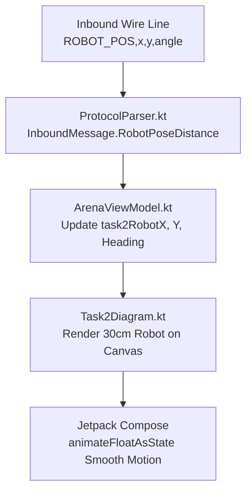

# Task 2 Live Robot Modeling: RPi Integration Spec & Implementation Plan

This document outlines the **RPi Team Integration Requirements** and the **Android App Implementation Plan** for continuous, distance-based live modeling of robot movements during Task 2.

---

## Part 1: Requirements for RPi Team

### 1. Bluetooth Wire Protocol Specification

The RPi communicates telemetry to the Android app over the existing Bluetooth Classic RFCOMM connection using line-terminated (`\n`) text frames.

#### A. Continuous Pose Updates (`ROBOT_POS`)
> [!IMPORTANT]
> To support smooth continuous movement modeling on the Task 2 diagram without discrete grid constraints, stream continuous centimeter coordinates and heading angle in degrees.

```
ROBOT_POS,<x_cm>,<y_cm>,<heading_deg>\n
```

* **`x_cm`** *(Float)*: Displacement in centimeters along the horizontal axis relative to the origin $(0,0)$.
* **`y_cm`** *(Float)*: Displacement in centimeters along the vertical axis relative to the origin $(0,0)$.
* **`heading_deg`** *(Float)*: Robot orientation angle in degrees ($0.0^\circ$ to $360.0^\circ$).
* **Example**: `ROBOT_POS,45.5,10.0,90.0\n`
* **Streaming Rate**: **5 Hz – 10 Hz** (every 100ms – 200ms) or on movement delta threshold ($\Delta x > 2\text{ cm}$ or $\Delta \theta > 5^\circ$).

#### B. Target & Arrow Detection (`TARGET`)
```
TARGET,<obstacle_id>,<target_id>,<face>\n
```
* **Example**: `TARGET,1,38,N\n` *(Obstacle 1 detected Target ID 38 = Right Arrow on North face)*
* **Example**: `TARGET,2,39,E\n` *(Obstacle 2 detected Target ID 39 = Left Arrow on East face)*

#### C. Status Feed (`MSG`)
```
MSG,[<status_text>]\n
```
* **Example**: `MSG,[Navigating to Obstacle 1]\n`
* **Example**: `MSG,[Task 2 Run Completed]\n`

---

### 2. Physical Coordinate Reference Frame

The RPi and Android tablet share the following continuous coordinate system:

| Axis / Parameter | Physical Definition |
| :--- | :--- |
| **Robot Footprint** | $25\text{ cm}$ (Length along travel direction) $\times 19\text{ cm}$ (Width). |
| **Initial Carpark Pose** | Centered vertically in carpark lot, flush with the rightmost exit edge ($70\text{ cm}$ from carpark back wall). |
| **Origin $(0,0)$** | Initial starting center position in the Carpark. |
| **$+X$ Axis** | Horizontal displacement towards Obstacle 1 and Obstacle 2 (Rightwards). |
| **$+Y$ Axis** | Vertical displacement perpendicular to the Carpark back wall. |
| **$0^\circ$ Heading** | Facing Right ($+X$, towards Obstacle 1). |
| **$90^\circ$ Heading** | Facing Up ($+Y$). |
| **$180^\circ$ Heading** | Facing Left ($-X$, back towards Carpark). |
| **$270^\circ$ Heading** | Facing Down ($-Y$). |

---

### 3. Non-Blocking RPi Architecture (Zero Speed Impact)

> [!TIP]
> Task 2 penalizes slow runs. Telemetry streaming must **never** block or delay the RPi's motor control or algorithm loop.

1. **Async Background Thread**: Push pose updates to a lightweight thread-safe queue. Write to Bluetooth RFCOMM from a background I/O thread.
2. **Latest-Frame Priority**: If the Bluetooth write queue builds up, overwrite or drop older pose frames.
3. **Fire-and-Forget**: RPi does not wait for tablet ACK frames.

#### Sample RPi Python Implementation:
```python
import queue
import threading
import time

pose_queue = queue.Queue(maxsize=1)

def bluetooth_sender_thread(bt_socket):
    while True:
        try:
            pose_str = pose_queue.get()
            bt_socket.send(pose_str.encode('utf-8'))
        except Exception as e:
            print(f"BT Send Error: {e}")

def push_robot_pose(x_cm, y_cm, heading_deg):
    msg = f"ROBOT_POS,{x_cm:.1f},{y_cm:.1f},{heading_deg:.1f}\n"
    if pose_queue.full():
        try:
            pose_queue.get_nowait() # Drop oldest frame
        except queue.Empty:
            pass
    pose_queue.put(msg)
```

---

### 4. HTTP Snapshot Image Server

* **Port**: `5001` (already configured in Android app).
* **Endpoints**: 
  - Obstacle 1 Image: `http://<rpi-ip>:5001/images/1`
  - Obstacle 2 Image: `http://<rpi-ip>:5001/images/2`

---

## Part 2: Android Implementation Plan



### Milestone 1: Data Model & Parser Extension
- Update `InboundMessage.kt` with `data class RobotPoseDistance(val xCm: Float, val yCm: Float, val headingDeg: Float)`.
- Update `ProtocolParser.kt` to parse `ROBOT_POS` verb and extract float values.
- Update `ArenaModels.kt` state to store continuous pose attributes (`task2RobotXCm`, `task2RobotYCm`, `task2RobotHeadingDeg`).

### Milestone 2: ViewModel State Wiring
- Update `ArenaViewModel.kt#handleIncomingLine` to handle `InboundMessage.RobotPoseDistance`.
- Add reset handler on `Clear` or `START` click.

### Milestone 3: Canvas Rendering & Animation in `Task2Diagram.kt`
- Compute pixel position using existing diagram scale factor:
  ```kotlin
  val robotPxX = offsetX + (robotXCm * scale)
  val robotPxY = cy - (robotYCm * scale)
  val robotPxSize = 30f * scale
  ```
- Apply `animateFloatAsState` for smooth motion transitions between 10 Hz Bluetooth emissions.
- Draw $30\text{ cm} \times 30\text{ cm}$ chassis rectangle with direction arrow / front bumper highlight.
- Draw breadcrumb trail path history (`Path`).

### Milestone 4: Unit Testing & Verification
- Unit test `ProtocolParserTest.kt` for `ROBOT_POS` parsing.
- Unit test `ArenaViewModelTest.kt` for Task 2 pose update state transitions.
- Verify zero UI lag and smooth 60 FPS rendering on target tablet.
