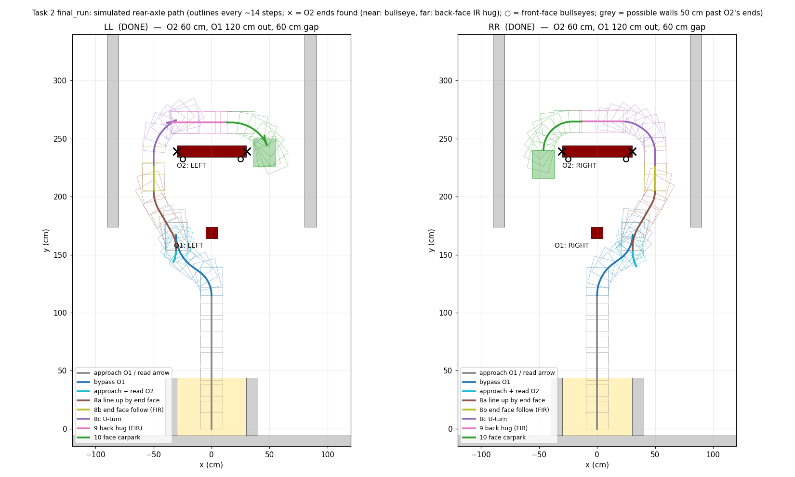
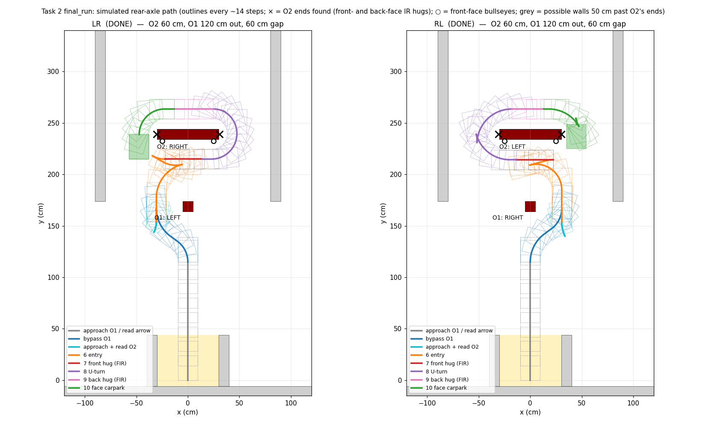

# Task 2 final algorithm (`final_run.py`)

The fastest-car run, from the carpark round both obstacles and back into the carpark.

**Status:** the default C-curve plan runs on the robot (robot runs 2026-10-14, team-reported). The older lane
route (`--lane-route`) is simulation and unit tests only.

## How to run

1. On the laptop, start the arrow picture page and open http://localhost:5001/ in a browser:

   ```
   python3 task2/rpi/arrow_server.py
   ```

2. On the Pi (use the laptop's address):

   ```
   cd ~/mdp_new/ash-dev/task2
   ~/mdp/.venv/bin/python final_run.py --pc <laptop address>
   ```

The page shows the two arrow pictures (camera image with bounding boxes) as soon as each arrow is read. The rules
need this screen at the end of the run: the supervisor photographs it, and the team emails a screenshot. The Pi
also keeps the pictures, tiled into `stitched.jpg`, in the run folder.

It loads the camera, then asks you to press Enter with
the robot in the carpark facing obstacle 1. Someone must stay at the power switch. Ctrl-C sends STOP. Every move is checked for collisions before it is sent;
any problem stops the run with no further movement.

Useful options:

| Option | What it does |
|---|---|
| `--no-heading-fix` | Turn off the IMU heading fix. With it on (the default) the Pi reads `IMU,GET` before every turn and straight: a turn is adjusted (up to 5 deg) to end at the plan's heading; a straight 2 deg or more off (1 deg fixes moved the wheels 0 counts in the 2026-10-15 run) starts with a short turn back to it (up to 5 deg, `MOV,FL/FR` or `MOV,BL/BR`) and is shortened by the distance that turn covers. Wall hugs are not fixed |
| `--camera-settle S` | Seconds the camera waits after the robot stops before a picture (default 0.15, was 0.3, saving about 0.3 s over the two arrow reads). Raise it if the saved raw pictures are blurred. Each look's time is now logged (`o1_arrow look 0: 1.23 s`). Not checked on the robot |
| `--no-fast-straights` | Drive every move in `--profile` (default PRECISION). By default a forward straight of 70 cm or more (`MOV,F,70`+) runs in `PROFILE,TASK2TEST` (twice the cruise speed; accurate for distance, team-tested 2026-10-15): the Pi sets it just before that straight and `--profile` again right after. Turns, short moves, reverses and the edge-follows stay in `--profile`. Host-tested only (sim); the saving (about 2-3 s) is an estimate. A profile that cannot be set runs the straight in `--profile`; one that cannot be set back stops the run |
| `--no-one-shot-park` | Always stop short and measure again when driving back into the carpark. By default, when the Pi's own position (the start placement `START_REAR_FROM_BACK_WALL_CM` = 5 cm, place the robot's back that far from the back wall every run, plus every planned move) puts the back wall within 5 cm of the first ultrasonic reading, it drives ONE straight to `PARK_US_CM` by the shorter of the two (saves a move and a reading, about 1.5-2 s, estimate). Disagreeing, it stops short as before but never past what the tracking allows. The log and result keep both distances (`park_tracked_cm`, `park_start_ultrasonic_cm`, `park_one_shot`): compare them after the first run and fix the placement value if they differ. Host-tested only |
| `--android` | Start from the tablet instead of Enter: listens on Bluetooth RFCOMM channel 1 (`sudo systemctl stop rfcomm` first), sends `MSG,[Pi ready: press START]` once ready, starts on `START` / `ALG:START` / `RESUME`, and sends the result (both arrows) as one `MSG` line at the end |
| `--pc ADDRESS` | Laptop running `arrow_server.py` (port 5001 if none given): shows the arrow pictures there |
| `--no-wall-hug` | Stop after the turn onto O2 (lane route: after reading O2's arrow) |
| `--c-curve` (default) | Approach O1 to 30 cm, read its arrow, the fixed C curve round O1 for that side; then, facing O2, read O2's arrow with the ultrasonic at 34.2 cm and make one 90 deg turn towards it (`FL,90` from 21.8 cm / `FR,90` from 34.2 cm) to end parallel to O2's front face, the side IR about 14 cm from it (robot runs). Then round O2 with fixed commands: side IR still beside O2 → wall hug the front face to its end; already past it → one reverse (the side IR's distance beyond O2's centre less REVERSE_INSIDE_CM short of O2's shortest reach; if the IR still sees nothing, 5 cm steps go on), then edge-follow forward until it is gone. The one-move reverse is host-tested only; replaces six 5 cm stops seen in the 2026-10-15 run. Then the U-turn onto the back face (`U_TURN_MOVES`), wall hug it to the other end, 90 deg turn to face the carpark as tight as clears O2 (`FACE_CARPARK_TURN`). Then back into the carpark: the gap between the obstacles (C curve end + ultrasonic) and O2's length (the two wall hugs) place O1, so one straight and one S-curve put the robot on O1's centre line past O1, and straights by the ultrasonic stop it 15 cm from the carpark's back wall (`PARK_US_CM`); stop (works on the robot, team-reported 2026-10-14). Part 3 ran on the robot for both O2 arrows on 2026-10-14 (team-reported: ends level with O2's back face, wheel 13 cm (LEFT) / 15 cm (RIGHT) from O2's end face). `--no-wall-hug` stops after the turn onto O2. Aims to end on O1's centre line; works with O2 60 cm behind O1 on the robot (the model needs 66.5 cm); O1 taken as straight ahead (no camera distances) |
| `--lane-route` | The older lane route instead of the C curve (simulation only) |
| `--fir-cap-cm N` | The most one wall hug may drive (default 150 cm) |
| `--o2-min-half-cm N` | Half the shortest length obstacle 2 can be (default 10 cm: O2 is at least 20 cm long, team statement). A real value gives shorter paths |
| `--stop-cm N` | Where obstacle 1's arrow is read (default 30 cm) |
| `--o2-read-cm N` | Where obstacle 2's arrow is read (default 60 cm) |

## What the robot does

Coordinates: x to the right, y towards the obstacles, from the robot's rear axle in the carpark.

1. Drive forward until the ultrasonic reads 30 cm from obstacle 1 (O1).
2. Read O1's arrow with the camera (one inference; a second only if the first finds no arrow at 0.5 confidence; none stops the run).
3. S-curve round O1 on the arrow's side into a lane about 31 cm beside it.
4. Drive forward until the ultrasonic reads 60 cm from obstacle 2 (O2).
5. Turn in a little, read O2's arrow, turn back.

Then round O2. Which way depends on the two arrows:

**Arrows different (LR, RL): hug both faces of O2**

6. Plan a path onto O2's front face, heading towards O2's arrow side, with the side IR level with O2's centre.
7. Wall hug the front face (`MOV,FIRL` or `MOV,FIRR`): the STM stops at O2's end.
8. U-turn round that end onto the back face.
9. Wall hug the back face the other way, to O2's other end.
10. Turn 90 degrees round that end to face the carpark, and stop.

**Arrows the same (LL, RR): use the bullseye**

The robot is already on the correct side of O2, so it skips the front face.

6. Find the bullseye on O2's front face on the arrow side. O2's end is taken as 5 cm beyond it.
7. Line up beside O2's end face (the short 10 cm side), facing north.
8. Edge-follow the end face with the side IR. The STM stops just past O2's back corner.
9. U-turn onto the back face, hug it to the other end, turn to face the carpark, and stop.

If no bullseye is seen, or no clear path exists, it uses the "arrows different" route instead (decided before
moving).

Simulated paths (O2 60 cm, O1 120 cm out, 60 cm gap):

- Arrows the same: 
- Arrows different: 

## Assumptions (team rules)

- O2 is always centred on O1. O2's centre is taken from O1's centre; O2's arrow is only a cross-check (a warning
  is logged if it is more than 6 cm off).
- O2's length is unknown.
- A wall may stand 50 cm beyond each end of O2 (briefing). No wall is assumed behind O2.
- The bullseye on O2's front face is about 5 cm from O2's end (team estimate, not measured).

## Values to measure or calibrate on the robot

| Value | Where | Now |
|---|---|---|
| Bullseye centre to O2's end | `BULLSEYE_TO_END_CM` | 5 cm (estimate) |
| Camera error on a bullseye at ~65 cm | `BULLSEYE_TOL_CM` | 3 cm (provisional) |
| Travel between an IR edge and the STM reporting it | `config.IR_EDGE_LAG_CM` | 0 (uncalibrated) |
| Hug cap | `FIR_CAP_CM` | 150 cm. A missed edge drives this far; it is not a wall guard |

## Check on the robot first (supervised)

- `MOV,FIRL` / `MOV,FIRR` stops at an edge (never bench-tested), and how far it overshoots.
- It sees the 10 cm end face reliably at about 14.5 cm and stops just past the back corner.
- The side IR reads about 14.5 cm after each line-up or U-turn.
- Odometry stays accurate over the planned moves, including reverses.

Note: the STM firmware does not yet send `DL`/`DR` at the end of an IR move, so `final_run.py` takes the travel
from the last motion sample (`fir_legacy_travel`, supervised runs only).

## Not done yet

- Driving back into the carpark on the lane route (`--lane-route`).
- `--android` (start from the tablet) has not been tried with the real tablet yet.

## Files

| File | What it is |
|---|---|
| `final_run.py` | The run: stages, path planner, wall hugs |
| `arrow_server.py` | Laptop page that shows the two arrow pictures |
| `stm_link.py`, `stm_task2.py`, `stm_fir.py`, `stm_us.py`, `stm_park.py`, `stm_protocol.py` | Talking to the STM (moves, IR edge-follow, ultrasonic, parking) |
| `config.py`, `geometry.py`, `ir.py`, `perception.py` | Robot measurements, move geometry, IR readings, camera |
| `tests/test_final_run.py`, `tests/test_arrow_server.py` | Tests (simulation, local HTTP) |
| `sim.py` | Simulated robot, obstacles, IR and camera used by the tests |

## Tests

No robot or camera needed (simulated robot and course):

```
cd task2
python3 -m unittest discover -s tests
```
